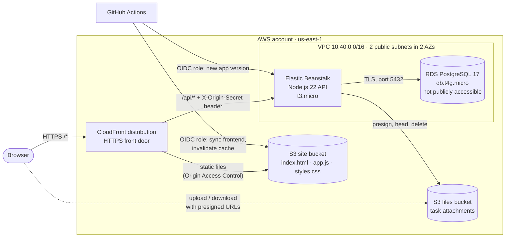
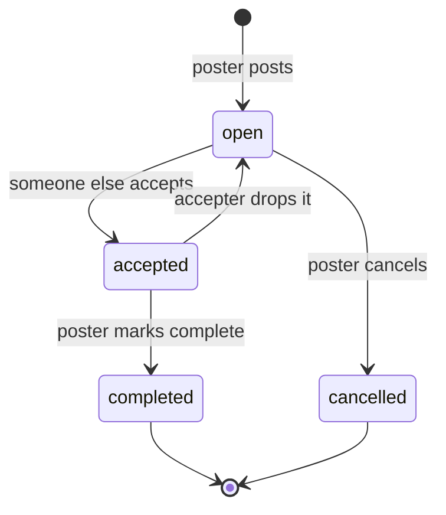
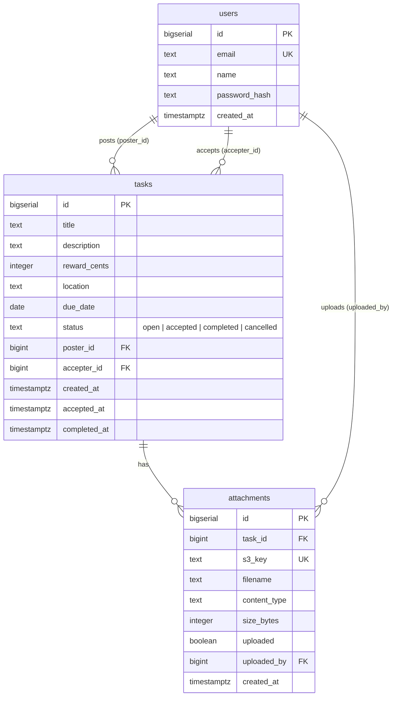
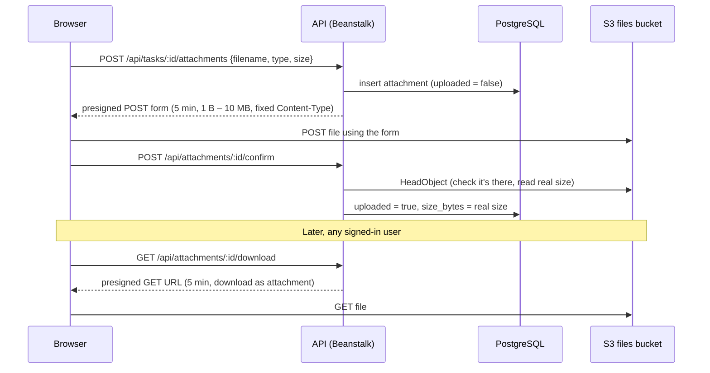

# Pitch In

Pitch In is a small task marketplace. People post jobs they need a hand with,
such as moving a couch or walking a dog, with an optional reward, a due date,
a location and file attachments. Other people browse open tasks and accept
them. The poster marks a task complete once it's done.

It runs on AWS. Terraform builds all of the infrastructure, and GitHub Actions
deploys the code on every push to `main`.

| Layer | Technology |
| --- | --- |
| Frontend | Plain HTML, CSS and JavaScript (no build step), hosted on S3 |
| CDN / HTTPS | Amazon CloudFront |
| API | Node.js 22 + Express on AWS Elastic Beanstalk (single EC2 instance) |
| Database | Amazon RDS for PostgreSQL 17 |
| File storage | Amazon S3 (private bucket, presigned URLs) |
| Infrastructure | Terraform (AWS provider 6.x) |
| CI/CD | GitHub Actions, signing in to AWS with OIDC (no stored AWS keys) |

---

## Architecture



### How a request flows

1. **Everything goes through one CloudFront domain.** The browser only ever
   talks to `https://<distribution>.cloudfront.net`. HTTP is redirected to
   HTTPS.
2. **Static files (`/*`)** come from the S3 site bucket. The bucket blocks all
   public access. Only this CloudFront distribution can read it, through
   Origin Access Control and a bucket policy pinned to the distribution's
   ARN. Responses get AWS's managed security headers policy.
3. **API calls (`/api/*`)** are forwarded to the Elastic Beanstalk environment
   with caching turned off. CloudFront adds a secret `X-Origin-Secret` header,
   and the API refuses any `/api` request without the right value (checked in
   constant time). The instance's Beanstalk hostname can't be used to skip
   CloudFront.
4. **Because the frontend and the API share one origin,** the browser calls
   relative `/api/...` paths. No CORS is needed for the API, and no API URL is
   built into the frontend.

### Components

#### Frontend (`frontend/`)

A single-page app with no framework and no build step. `index.html` holds
`<template>` blocks for each screen, and `app.js` swaps them in with a small
hash router:

| Route | Screen |
| --- | --- |
| `#/` | Sign in / create account |
| `#/browse` | Open tasks posted by other people, with search |
| `#/post` | Post a task, with up to 10 files |
| `#/mine` | Tasks I posted and tasks I accepted |
| `#/task/:id` | Task details, files and actions (accept, drop, complete, cancel) |

The session token is a JWT kept in `localStorage` and sent as
`Authorization: Bearer <token>`. All user content is HTML-escaped before it's
rendered.

#### API (`backend/`)

An Express app (`src/server.js`) running on Elastic Beanstalk's Amazon Linux
2023 Node.js 22 platform, as a single-instance environment with no load
balancer. Beanstalk's nginx proxies to the app on port 8080.

| Method & path | Purpose |
| --- | --- |
| `GET /api/health` | Health check that also runs `SELECT 1` against the database |
| `POST /api/auth/register` | Create an account (bcrypt, cost 12) and return a JWT |
| `POST /api/auth/login` | Sign in and return a JWT (valid for 7 days) |
| `GET /api/me` | The signed-in user |
| `GET /api/tasks?q=` | Open tasks from other people, with search on title, description and location |
| `GET /api/tasks/mine` | Tasks I posted and tasks I accepted |
| `POST /api/tasks` | Post a task |
| `GET /api/tasks/:id` | Task details and its uploaded files |
| `POST /api/tasks/:id/accept` | Accept an open task (not your own) |
| `POST /api/tasks/:id/release` | Accepter drops the task, which reopens it |
| `POST /api/tasks/:id/complete` | Poster marks an accepted task complete |
| `POST /api/tasks/:id/cancel` | Poster cancels an open task |
| `POST /api/tasks/:id/attachments` | Poster asks for a presigned S3 upload form |
| `POST /api/attachments/:id/confirm` | Confirm the file reached S3 |
| `GET /api/attachments/:id/download` | Get a 5-minute presigned download URL |
| `DELETE /api/attachments/:id` | Poster removes a file |

Every route except health, register and login requires a signed-in user.

**Task lifecycle.** Each status change is a single conditional `UPDATE`
(for example `... WHERE status = 'open' AND poster_id <> $me`). Two people
can't accept the same task, because only one update can match.



On startup the API creates its tables if they don't exist (`src/db.js`). It
retries up to 10 times while the database is still coming up.

#### Database (RDS PostgreSQL)

- PostgreSQL 17 on `db.t4g.micro` with 20 GB of encrypted gp3 storage and
  7 days of automated backups.
- `publicly_accessible = false`. Its security group only allows port 5432
  from the API's security group.
- The API connects over TLS and checks the server certificate against the
  RDS CA bundle in `backend/rds-ca-bundle.pem`.



#### File attachments (S3)

The files bucket is private and encrypted (SSE-S3). File contents never pass
through the API server. The browser uploads to and downloads from S3
directly:



- Objects are stored as `attachments/<task id>/<random UUID>`. The original
  filename is only kept in the database.
- Limits: 10 MB per file, 10 files per task, and only the poster can add or
  remove files.
- Bucket CORS only allows `POST` and `GET` from the CloudFront domain.
- A lifecycle rule cleans up incomplete multipart uploads after one day.

#### Network

- One VPC (`10.40.0.0/16`) with two public subnets in two availability zones.
  RDS needs two AZs for its subnet group.
- The Beanstalk instance gets a public IP for outbound internet access, so
  there's no NAT gateway to pay for.
- The database sits in the same subnets but has no public endpoint, and only
  the app security group can reach it.
- There's no SSH key. Admins can reach the instance with AWS Systems Manager
  Session Manager (`AmazonSSMManagedInstanceCore` is attached), for example
  for database maintenance.
- The instance only accepts IMDSv2, and its logs stream to CloudWatch Logs
  (kept for 14 days).

---

## Security

| Concern | How it's handled |
| --- | --- |
| Secrets in the repo | None. The DB password, JWT secret and origin secret are made by Terraform's `random_password` and passed to Beanstalk as environment variables. They only exist in Terraform state, which is git-ignored. |
| AWS credentials in CI | None stored. GitHub Actions gets short-lived credentials through OIDC. The trust policy only allows the `main` branch of this repository, matched by GitHub's immutable owner and repo IDs. |
| Least privilege | The frontend deploy role can only write to the site bucket and invalidate this distribution. The backend deploy role can only create versions and update this one Beanstalk environment. The instance role can only read, write and delete `attachments/*` in the files bucket. |
| Direct access to the API instance | Blocked by the `X-Origin-Secret` header check. |
| Passwords | bcrypt with cost 12. Never returned by the API. |
| SQL injection | All queries are parameterised. `LIKE` wildcards in searches are escaped. |
| XSS | All user content is escaped in the frontend. Responses use CloudFront's managed security headers. |
| Database in transit | TLS with full certificate verification. |
| Data at rest | RDS storage and the files bucket are encrypted. Both S3 buckets block all public access. |

**Known trade-offs** (to keep it cheap and simple):

- The hop from CloudFront to Beanstalk is plain HTTP
  (`origin_protocol_policy = "http-only"`), because the single-instance
  environment has no load balancer or certificate. The origin secret stops
  people from skipping CloudFront, but that hop isn't encrypted.
- One EC2 instance and a single-AZ database means no high availability.
- `deletion_protection = false` and `skip_final_snapshot = true` on RDS, and
  `force_destroy = true` on the buckets, so `terraform destroy` cleans up
  completely. Change these before storing data you care about.
- JWTs can't be revoked before they expire (7 days). Deleting a user does
  invalidate their token, because every request looks the user up.

---

## Deployment

### What deploys what

| Part | Deployed by | When |
| --- | --- | --- |
| AWS infrastructure | Terraform (`infra/`) | You run `terraform apply` |
| Frontend | `.github/workflows/deploy-frontend.yml` | Push to `main` that changes `frontend/**`, or a manual run |
| Backend | `.github/workflows/deploy-backend.yml` | Push to `main` that changes `backend/**`, or a manual run |

**Frontend workflow:** checks `app.js` syntax, uploads files to the site
bucket with the right content types and `Cache-Control: no-cache`, deletes
removed files, then invalidates the CloudFront cache and waits for it to
finish.

**Backend workflow:** runs `npm ci` and a syntax/import check, zips
`backend/` (without `node_modules`), uploads it to Beanstalk's own S3 bucket,
and registers it as a new application version. Beanstalk validates the zip,
then the workflow switches the environment to it and waits until it's
`Ready` and `Green` on the new version. Last, it calls `/api/health` through
CloudFront as a smoke test. Beanstalk keeps the 30 newest versions.

### First-time setup

Prerequisites: an AWS account, the AWS CLI signed in with admin rights,
Terraform 1.6 or newer, and a GitHub repository for this code.

1. **Point the deploy roles at your repository.** `github_repo` in
   `infra/github.tf` must match the `sub` claim of GitHub's OIDC token, in the
   form `owner@ownerId/repo@repoId`. If you fork this repo, override it, for
   example in an `infra/terraform.tfvars` file (git-ignored):

   ```hcl
   github_repo = "your-user@12345678/your-repo@987654321"
   ```

   Your numeric IDs are in `https://api.github.com/users/<user>` and
   `https://api.github.com/repos/<user>/<repo>`.

2. **Create the infrastructure** (about 15–20 minutes, mostly RDS and
   Beanstalk):

   ```bash
   cd infra
   terraform init
   terraform apply
   ```

   An AWS account can only have one GitHub OIDC provider. If yours already
   has one, import it before you apply:

   ```bash
   terraform import aws_iam_openid_connect_provider.github arn:aws:iam::<account-id>:oidc-provider/token.actions.githubusercontent.com
   ```

3. **Give GitHub Actions the values it needs.** Print them:

   ```bash
   terraform output github_actions_variables
   ```

   Add each one under the repository's **Settings → Secrets and variables →
   Actions → Variables**: `AWS_ROLE_ARN`, `SITE_BUCKET`,
   `CLOUDFRONT_DISTRIBUTION_ID`, `AWS_BACKEND_ROLE_ARN`, `EB_BUCKET`,
   `EB_APPLICATION`, `EB_ENVIRONMENT` and `SITE_URL`. None of them are
   secrets.

4. **Deploy the code.** Run both workflows once from the **Actions** tab
   (**Run workflow**). Until the backend workflow runs, a new environment
   runs Beanstalk's sample app.

5. **Open the site** at the URL from `terraform output site_url`.

After that, pushing to `main` deploys automatically.

### Tearing it down

```bash
cd infra
terraform destroy
```

This deletes the database (with no final snapshot) and empties both buckets.

### Approximate cost

Everything is the smallest size: one `t3.micro`, one `db.t4g.micro` with
20 GB, and CloudFront `PriceClass_100` (North America and Europe). There's no
NAT gateway or load balancer. With light traffic it's roughly the cost of
those two instances, and part of that may fall under the AWS Free Tier.

---

## Running the API locally

```bash
cd backend
npm install
DB_SSL=false DB_HOST=localhost DB_USER=postgres DB_PASSWORD=postgres DB_NAME=pitchin \
JWT_SECRET=dev-only-secret npm start
```

This needs a local PostgreSQL with a `pitchin` database. The tables are
created on startup. Attachments also need `FILES_BUCKET` set to an S3 bucket
and AWS credentials. Leave `ORIGIN_SECRET` unset locally, and the header
check is skipped.

The frontend calls relative `/api/...` paths, so to use it locally, serve
`frontend/` and the API from the same origin (for example behind a small
reverse proxy that sends `/api` to port 8080).

| Variable | Purpose | Default |
| --- | --- | --- |
| `PORT` | Port to listen on | `8080` |
| `DB_HOST`, `DB_PORT`, `DB_NAME`, `DB_USER`, `DB_PASSWORD` | PostgreSQL connection | `localhost`, `5432`, `pitchin`, `postgres`, `postgres` |
| `DB_SSL` | Set to `false` to turn TLS off (local only) | TLS on |
| `JWT_SECRET` | Signs session tokens | **required** |
| `ORIGIN_SECRET` | Expected `X-Origin-Secret` header value | check skipped if unset |
| `FILES_BUCKET` | S3 bucket for attachments | none |
| `AWS_REGION` | Region for the S3 client | `us-east-1` |

---

## Repository layout

```
.
├── .github/workflows/
│   ├── deploy-backend.yml    # zip backend → new Beanstalk version → deploy → smoke test
│   └── deploy-frontend.yml   # sync frontend to S3 → invalidate CloudFront
├── backend/
│   ├── src/
│   │   ├── server.js         # Express routes, origin-secret check, error handling
│   │   ├── auth.js           # bcrypt, JWT issue/verify, requireUser middleware
│   │   ├── db.js             # pg pool (TLS to RDS) and schema migration
│   │   └── files.js          # S3 presigned POST/GET, head, delete
│   ├── rds-ca-bundle.pem     # Amazon RDS public CA certificates
│   └── package.json
├── frontend/
│   ├── index.html            # page shell and screen templates
│   ├── app.js                # hash router, API client, screens
│   ├── styles.css
│   └── favicon.svg
└── infra/
    ├── main.tf               # providers, variables, VPC, subnets, security groups
    ├── storage.tf            # S3 site and files buckets
    ├── database.tf           # RDS PostgreSQL
    ├── beanstalk.tf          # Beanstalk app/environment, IAM roles, generated secrets
    ├── cdn.tf                # CloudFront distribution, outputs
    └── github.tf             # GitHub OIDC provider and deploy roles
```
